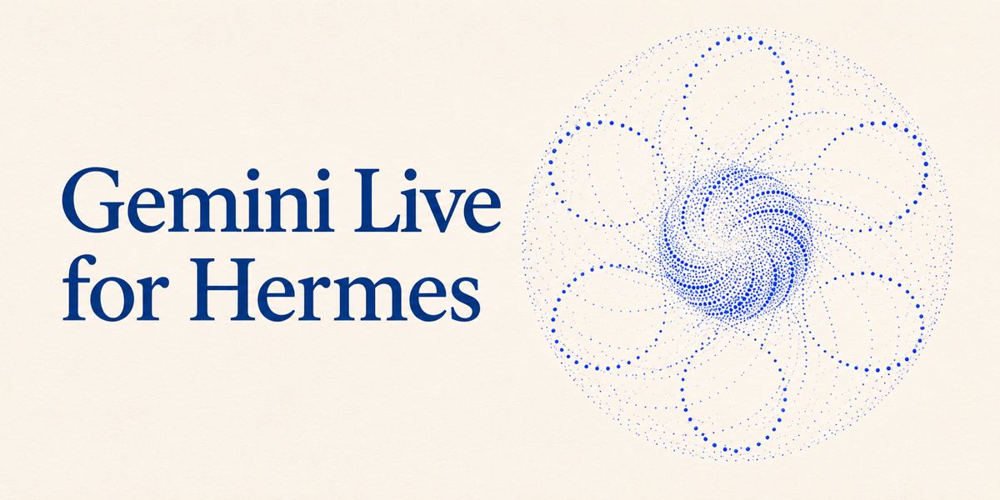

# Gemini Live for Hermes



Full-duplex voice calls with your Hermes agent, powered by the Gemini Live API. Talk naturally,
interrupt any time, and let the voice hand real work to Hermes while you keep talking. It can watch
and steer your other threads, bot chats and subagents, recall your memory, check the server, and
tell you when the work is done.

Bring your own Gemini API key. Works in **Hermes Desktop** and the **web dashboard**.

The voice takes the name of the profile you start the call from: its display name, then its bot name, then its profile name, then Hermes. The transcript, status and activity use that name too, and the voice treats background work as itself.

## What the voice can do

| Area | Tools | Notes |
|---|---|---|
| Delegate | `ask_hermes`, `check_hermes`, `cancel_hermes` | Hands a self-contained request to your real Hermes agent (all its tools, skills and approvals). Progress is live; the result is spoken when you go quiet. A running job is never interrupted or piled onto: a change of mind steers it, and anything else waits. |
| Threads & bots | `list_threads`, `read_thread`, `message_thread`, `stop_thread` | Running threads, recent chats and Bot Mode chats. `message_thread` steers a running turn, or starts one on an idle thread. With no thread it steers the job running for this call. Changes other threads only when you ask. |
| Subagents | `list_subagents`, `steer_subagent` | Goal, status and latest output of each subagent; steer one without stopping it. |
| Your setup | `agents_overview` | Every profile/bot: name, description, **model and provider** (e.g. `openai-codex` = ChatGPT subscription login), skill count, latest bot-chat activity. Never keys or credentials. |
| MCP | `list_mcp_tools`, `use_mcp_tool` (on by default) | The voice is told which MCP servers and tools this profile has, and can use them. Each use runs as a one-tool Hermes turn, so Hermes' MCP trust, credentials and approvals still apply. |
| iPhone | `mobile_alarm_create`, `mobile_timer_start`, `mobile_alarms_list`, `mobile_alarm_cancel`, `mobile_reminder_create`, `mobile_reminders_list`, `mobile_reminder_complete`, `mobile_request_result` (on by default) | Alarms, timers and reminders straight from the voice, without a Hermes turn. Needs the `hermes-mobile-device-access` plugin and a paired iPhone, and each tool appears only when the Hermes Agent app has granted that access. The voice says it's done only once the phone confirms. A sleeping phone can take a while or miss the request, and the voice says it's waiting rather than guessing. Everything else on the phone goes through `ask_hermes`. |
| Memory | `recall_memory`, `search_conversations` | Hermes' built-in memory and session search directly. An external provider (Honcho, Hindsight…) is searched through a Hermes turn, so its credentials stay with Hermes. |
| The server | `run_readonly` (opt-in), `system_check` (opt-in) | See [Read-only commands](#read-only-commands). |
| Web | Google Search grounding | Quick facts without a Hermes turn. Can be turned off. |
| The call | `end_call`, `pause_listening`, `switch_persona`, `change_voice` | Personas: Hermes, Concise, Coach, Briefing, plus your own. |

Reliability built in: session resumption across Gemini's socket rotation, quota/policy closes end
the call with a next step instead of looping, updates never talk over the model, steady background
noise can't hold an update back for more than ~8 s, and if the model *says* it will do something
without calling the tool, it is nudged once to follow through.

## Where work runs

The voice decides where each task runs. Work related to the chat you started the call from goes in that chat, and unrelated work starts a new session. A follow-up stays with the last task, and a change of mind while it runs steers it. If it can't tell, it asks you.

## Approvals on a call

When a job needs permission, the voice tells you what it wants to do and Approve and Deny buttons appear on the call. Hermes' approval system still decides what needs asking, and the voice model has no way to answer. Turn on `voice_approval` to answer hands-free by saying "approve" or "deny": the plugin matches your whole utterance on the microphone transcript, ignores it while the voice is speaking, and approves once only. Use headphones with it.

With the AirPods Approvals plugin installed, you can also nod to approve or shake your head to deny. The voice asks the question, AirPods Approvals stays quiet and only listens for the gesture, and the voice confirms the answer. Hermes still gets each answer once, from whichever way you gave it.

## Read-only commands

`run_readonly` lets the voice answer "is the backup container up?" or "what do the last log lines
say?" directly. A command runs only if **every** layer agrees, and each layer can only refuse:

1. **Hard rules (code).** An allow-list of programs and sub-commands (`df`, `du`, `free`, `ps`,
   `ls`, `cat`/`head`/`tail`, non-recursive `grep`, bounded `find`, `git status/log/diff`,
   `docker ps/logs`, `systemctl status`, `journalctl`, `ss`, `ip`, `tailscale status`…). No shell
   syntax at all (pipes, redirects, chaining, `$`, backticks), no `sudo`, no `env`, no interpreters,
   no `-exec`/`-delete`, no `docker inspect/exec`. Secret paths (`.env`, `~/.ssh`, keys, tokens,
   `auth.json`, `/proc/*/environ`, and everything under `/etc` except a few plain system files
   such as `hostname` and `os-release`) are refused, resolved through symlinks.
2. **Safety review.** A Gemini model (default `gemini-3.5-flash-lite`, your key) sees the command
   *and the recent call transcript*, so it can refuse something risky or something you did not
   actually ask for. Server safety comes first. Transcript text is treated as data, so a
   prompt-injection line read aloud is refused. If the review fails or is unclear, nothing runs.
3. **Contained run.** No shell, a minimal environment (no inherited secrets), no stdin, a 10 s
   timeout, CPU and file-size limits (it cannot write a file), and redacted, capped output.

Anything that changes the machine goes to Hermes (`ask_hermes`) and its normal approval flow. The iPhone tools are the one direct write the voice has, limited to the phone's alarms, timers and reminders and to what the app allows.

The other routes to Hermes (`ask_hermes`, `message_thread`, `steer_subagent`, `use_mcp_tool`) refuse requests to read or reveal `.env` files, keys, tokens, passwords and credentials, and the voice is told not to offer a way around that. This is a text check on what the voice sends, so treat it as a strong guard rather than a sandbox: Hermes itself keeps its normal file access and approvals.

## Install

```bash
hermes plugins install cineglobe/hermes-gemini-live --enable
hermes config set GEMINI_LIVE_API_KEY <your key>     # https://aistudio.google.com/apikey
hermes gemini-live doctor                             # checks the key and lists your Live models
```

A free Gemini API key works, within Google's free-tier limits. If a new call is over quota before Gemini speaks, it retries without Google Search and then on `gemini-2.5-flash-native-audio-latest`, and says so in the transcript.

`GEMINI_API_KEY` / `GOOGLE_API_KEY` are used if `GEMINI_LIVE_API_KEY` is not set. The key stays on
the Hermes backend: the browser only ever gets a single-use, 30-minute ephemeral token whose model,
voice, instructions and tools are locked server-side.

### Where it shows up

- **Desktop:** in the composer's voice-engine picker as **Gemini Live**, next to the built-in
  engines, when your Desktop has the `composer.voiceEngines` area (see below). The start-voice
  button then starts a Gemini Live call. On older Desktop builds it adds its own call button. Also:
  a **Gemini Live** page in the sidebar (call screen, transcript, activity, threads), a status-bar
  chip during a call, and palette commands (*Gemini Live: Start voice call*, *End call*, *Toggle mute*).
- **Web dashboard:** a **Gemini Live** tab with the same call screen.

### Settings (`plugins.entries.gemini-live.settings`, or Settings → Plugins)

| Key | Default | |
|---|---|---|
| `model` | `gemini-3.8-live` | Any Live model your key can use; the call screen lists them. |
| `voice` / `persona` | `Laomedeia` / `hermes` | Changeable mid-call. |
| `custom_instructions`, `custom_personas` | — | Your own style rules and personas. |
| `google_search`, `thread_control`, `share_chat_context`, `mcp_tools`, `phone_tools` | on | `phone_tools` does nothing without a paired iPhone. |
| `system_checks`, `readonly_shell` | **off** | Server access is opt-in. |
| `readonly_reviewer_model` | `gemini-3.5-flash-lite` | The safety reviewer. |
| `turn_detection` | `balanced` | `patient` / `balanced` / `snappy`. |

## A Gemini Live entry in the built-in voice pickers

**Desktop.** The plugin SDK had no way to add an engine to the composer's voice picker, so this
project includes a small companion change to Hermes Desktop (`upstream/desktop-voice-engines.patch`):
a `composer.voiceEngines` contribution area. Plugin engines are listed after the core rows; choosing
one is remembered per connection and profile and routes the start-voice button to the plugin. No
backend change, and nothing changes for users without such a plugin. The plugin detects the area and
uses it automatically.

**Mobile — a request to the Hermes team.** The Hermes mobile app currently offers only GPT Live, and
its source is not public yet, so we could not add it ourselves. We would love **Gemini Live as an
option in the mobile voice picker** too. Everything the app would need already exists on the
backend side of this plugin (`/api/plugins/gemini-live/session` mints the locked ephemeral token;
the tool router and delegation logic are framework-free in `src/engine.js`).

**Open offer.** If the Hermes maintainers would like it, we are happy to contribute the whole thing
to Hermes itself: the backend, the Desktop and dashboard UIs, and help with mobile, so Gemini Live
becomes a built-in voice engine everywhere next to GPT Live. Just say the word in the PR or an issue.

## Guides

- [`docs/MAC_SETUP.md`](docs/MAC_SETUP.md): install into a local Hermes Desktop and run the end-to-end checklist.
- [`docs/UNINSTALL.md`](docs/UNINSTALL.md): undo the whole install, including the optional picker patch and demo tools.

## What this plugin does on your machine

- **Network:** calls Google's Gemini API (`generativelanguage.googleapis.com`) with your key, from the Hermes backend, and your call audio and the instructions for the call go to Google over a browser WebSocket. It sends a recent call transcript to the safety reviewer model when `run_readonly` is on. Google Search grounding is on by default.
- **Reads outside its own data:** the profile's display name from `profile.yaml`, Hermes' built-in memory notes, session history and thread list, the open chat's title and latest messages (`share_chat_context`), profile names and models, and the MCP tool list. Never credentials.
- **Shell commands:** only with `readonly_shell` or `system_checks` turned on, which are off by default. These run on the Hermes host under the layers above, not through Hermes' approval prompts, because they can't change anything. Anything that changes the machine goes through Hermes.
- **Credentials:** your key is read through Hermes' secret scope. The browser only receives a single-use ephemeral token.
- **Background processes and telemetry:** none.

## Development

```
glive_core.py         backend: settings, key, model list, token mint, tool catalog, memory, server tools
glive_shell.py        run_readonly: rules → review → contained run
dashboard/plugin_api.py  REST routes at /api/plugins/gemini-live (shared by Desktop and dashboard)
src/engine.js         the call engine (audio, Gemini Live socket, tool router, delegation) — no imports
src/desktop.js        Desktop shell        src/dashboard.js  dashboard shell        src/ui.css  styles
scripts/build.py      inlines the engine/CSS into desktop/plugin.js and dashboard/dist/ (--check for CI)
upstream/             the companion Desktop patch and its PR notes
```

```bash
python scripts/build.py            # regenerate the bundles after editing src/
scripts/test.sh                    # Python + engine tests with Hermes' own interpreter (never starts a server)
GLIVE_LIVE=1 GLIVE_HOME=<a hermes home with a key> node tests/engine.test.mjs   # real Gemini Live calls
```

Never start a second `hermes serve`/`hermes dashboard` on a machine whose Hermes backend runs as a
service while testing: a new backend can reap the running one as an orphan. The tests above never do.

## License

MIT © cineglobe
